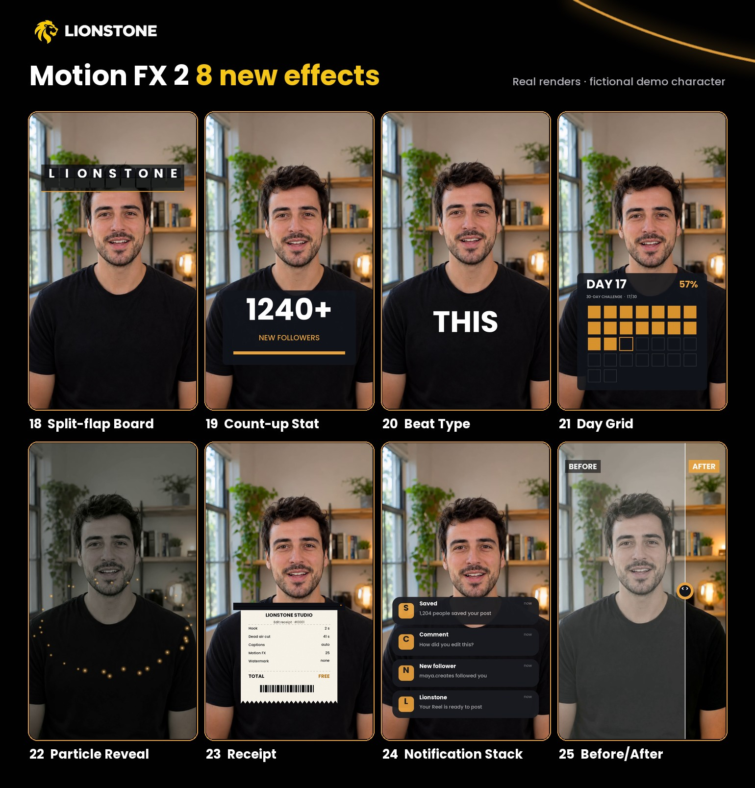

# Motion FX 2: eight more effects, Theatre.js keyframes and a Synfig backend



*Above: real Lionstone renders (`lionstone fx clip`, the same code as the export) on a
fictional example character. Use `lionstone fx preview` to see them on your own footage.*

Motion FX 2 adds eight effects to the [Motion FX Pack](motion-fx.md), which now has 25
effects. They follow the same rules: one command each, 9:16, 1:1 and 16:9 from one preset,
plain FFmpeg plus the bundled fonts, free and open source (Apache-2.0). Lionstone also gets
two optional creative backends: **Theatre.js** keyframes for Remotion titles and **Synfig**
animations rendered by the Synfig program you install yourself.

## Quick start

```bash
lionstone fx list --category motion-fx          # all 25
lionstone fx show count-up                      # every parameter with its range

lionstone fx clip split-flap talk.mp4 -o board.mp4 --param text=DAY ONE
lionstone fx apply plan.json count-up --source 2-6 --param value=12500 --param suffix=+
lionstone fx apply plan.json beat-type --source 0-8 --param bpm=124 --param "text=STOP SCROLLING NOW"
lionstone fx apply plan.json receipt --source 10-15 --param "items=Hook=2 s|Cuts=14|Captions=auto"
lionstone fx render plan.json
```

## The 8 new effects

| # | Effect | Promise | Key parameters (default) | Cost |
|---|---|---|---|---|
| 18 | `split-flap` | a departures board spells your word | `text` LIONSTONE · `y` 0.22 · `flips` 8 · `rate` 14/s · `stagger` 0.07 s · `tile` `ink` `accent` | medium |
| 19 | `count-up` | your number counts up on a card | `value` 1240 · `decimals` 0 · `prefix` · `suffix` + · `label` · `y` 0.6 · `draw` 1.6 s | low |
| 20 | `beat-type` | words land on the beat | `text` · `bpm` 120 · `offset` 0 s · `y` 0.7 · `pulse` 0.035 · `ink` `accent` | low |
| 21 | `day-grid` | day 17 of 30 | `day` 17 · `total` 30 · `label` · `y` 0.74 · `fill` 1.2 s · `panel` `accent` | low |
| 22 | `particle-reveal` | sparks gather into your title | `title` · `subtitle` · `count` 36 · `y` 0.62 · `converge` 1 s · `size` · `dim` · `color` | medium |
| 23 | `receipt` | the receipt for your result | `title` · `subtitle` · `items` "label=value\|…" · `total` · `x` `y` · `print` 1.8 s · `paper` `ink` `accent` | medium |
| 24 | `notification-stack` | your phone lights up | `items` "Title: message\|…" (up to 4) · `y` 0.52 · `interval` 0.7 s · `panel` `accent` | medium |
| 25 | `before-after` | slide between before and after | `before` · `after` · `look` flat/mono/soft · `sweeps` 0.75 · `line` `accent` | medium |

* **Split-flap Board.** Each tile flips through random letters at `rate` flips per second and
  lands on its letter, left to right (`stagger`). The flips are the same on every render.
* **Count-up Stat.** Counts from 0 to `value` with an ease-out over `draw` seconds while an
  accent bar fills. `prefix`/`suffix` take `$`, `+`, `%`, `K` and so on.
* **Beat Type.** One word per beat at `bpm`; set it to your music's tempo and use `offset`
  to line the first word up with the first beat. Every fourth word is a size larger, and the
  frame pulses (`pulse`) on each beat.
* **Day Grid.** For series and challenges: the squares fill up to `day`, today's square
  blinks, with the percentage done.
* **Particle Reveal.** An intro or logo moment: glowing sparks swirl in, form a ring, flash
  and burst outwards as the title fades in. The idea comes from particle tools such as
  Effekseer; the particles here are pure FFmpeg overlays.
* **Receipt.** Prints from a slot with a little printer stutter. Items are `label=value`
  pairs separated by `|`; `total` is `label=value` too.
* **Notification Stack.** Cards drop in with a spring, newest on top, each with an accent
  icon showing the title's first letter.
* **Before/After.** The left side gets a flat, mono or soft "before" look, the right side a
  punchier grade, and a handle sweeps between them.

Text parameters are written to a file for FFmpeg, so quotes, colons and `%` are safe. The
text effects need FFmpeg's `drawtext`; without it, bars stand in for the text and nothing
fails. Moving parts are overlays, so the effects stay fast at 1080x1920.

## Theatre.js keyframes for Remotion titles

The Remotion title pack (`remotion/`) can now drive any value from a
[Theatre.js](https://www.theatrejs.com/) keyframed sequence:

```tsx
import { theatreState, useTheatreSequence } from "../lib/theatre";

const v = useTheatreSequence({
  project: "MyTitle", sheet: "Title", object: "Word",
  props: { y: 0, opacity: 1 },
  state: theatreState("Title", "Word", {
    y: [{ at: 0, value: -0.1 }, { at: 0.8, value: 0 }],
    opacity: [{ at: 0, value: 0 }, { at: 0.4, value: 1 }],
  }, 3),
});
// v.y and v.opacity are the values at the current Remotion frame
```

The hook sets the sequence position to `frame / fps` and reads the values, so it works with
Remotion's out-of-order, parallel rendering; it holds the render (`delayRender`) until the
Theatre project is ready. See `remotion/src/effects/TheatreKeyframedTitle.tsx` for a full
example (composition `TheatreKeyframedTitle`):

```bash
cd remotion && npx remotion still src/index.ts TheatreKeyframedTitle title.png --frame=40
```

**Licence.** Lionstone depends only on `@theatre/core`, which is Apache-2.0. Theatre's
visual keyframe editor, `@theatre/studio`, is AGPL-3.0 and is **not** part of Lionstone. If
you want to edit keyframes visually, use Studio in a separate project of your own, export
the state JSON and pass it as `state`.

## Synfig animations (optional external backend)

[Synfig Studio](https://www.synfig.org/) is a free 2D animation app. Lionstone can render a
Synfig file and put it over your clip:

```bash
lionstone fx synfig lower-third.sif --input talk.mp4 -o out.mp4 --start 2.5
lionstone fx synfig logo.sif -o frames/ --width 1080 --height 1920 --fps 30   # PNG sequence only
```

The `synfig` command-line renderer draws the animation at your clip's size and frame rate
as transparent PNGs, and FFmpeg composites them from `--start` seconds (audio is copied).
If `synfig` is not installed, Lionstone says how to install it and stops; nothing else
depends on it.

**Licence.** Synfig is GPL-3.0. Lionstone never imports, bundles or links Synfig code; it
runs the `synfig` program you installed as a separate process, the same way it runs
FFmpeg.

## Credits and originality

Every effect name, look and line of code here is original to Lionstone
(`license.source = "lionstone-original"`). Some ideas were inspired by public lists of
canvas animation ideas, such as split-flap boards, count-ups and receipts; no prompt text
or code from those lists was copied. No stock footage, overlays or LUTs are bundled.
Regenerate the catalogue with `python tools/gen_motion_presets.py` and the docs picture with
`python scripts/build_motionfx_visuals.py portrait.png logo.png --fx2`.
