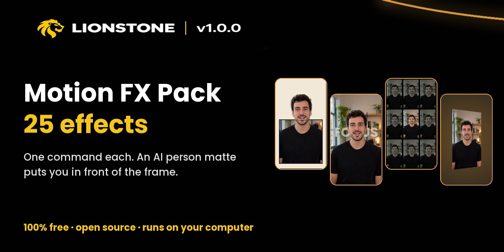
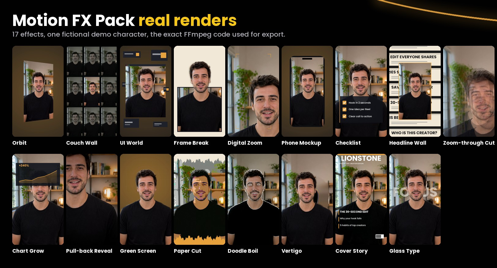
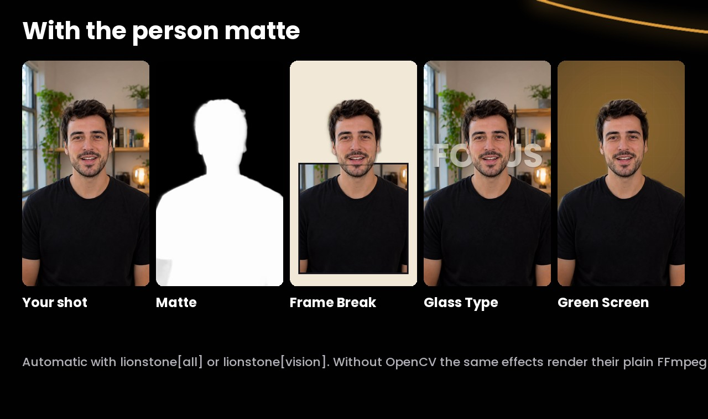

# Motion FX Pack: 17 motion-design effects (new in Lionstone 1.0)



Motion FX brings the edits you see on the best creator channels to one command each: the
camera orbiting you, a wall of screens, your head breaking out of a frame, big glass type
that sits behind you, a dolly zoom, a magazine cover. They work on 9:16, 1:1 and 16:9 and
render with the same FFmpeg code in the preview, the showcase reel and the final export.

Like everything in Lionstone, the pack is free and open source (Apache-2.0): no key, no
watermark, no upload. *Pro* and *Studio* are only catalogue labels.

> **New: [Motion FX 2](motion-fx-2.md)** adds 8 more effects (split-flap board, count-up
> stat, beat type, day grid, particle reveal, receipt, notification stack, before/after),
> Theatre.js keyframes for Remotion titles and an optional Synfig backend.



*Above: real Lionstone renders on a fictional example character. Use `lionstone fx preview`
to see the result on your own footage.*

## Quick start

```bash
pip install "lionstone[all] @ git+https://github.com/ismailarslantas/lionstone"

lionstone fx list --category motion-fx
lionstone fx show glass-type

# real low-res preview, same builder as the export
lionstone fx preview frame-break --input talk.mp4 --start 12 --before-after

# apply to the whole video, a segment or a time range, then render
lionstone fx apply plan.json orbit --source 0-4
lionstone fx apply plan.json checklist --source 20-26 --param "items=Hook in 2 seconds|One idea|Call to action"
lionstone fx apply plan.json glass-type --source 3-6 --param text=FOCUS
lionstone fx render plan.json

# a 6.4 s 1080x1920 "one command" reel for any effect
lionstone fx showcase vertigo talk.mp4 --start 8
```

## The person matte: what makes five effects look premium

Frame Break, Vertigo, Glass Type, Green Screen and Doodle Boil know where *you* are in
the shot. Lionstone cuts you out of every frame with a small AI model and uses that matte
to put you in front of the frame, the type or the new backdrop.



* **Automatic.** With `lionstone[all]` or `lionstone[vision]` installed (OpenCV), the matte is
  built the first time a render needs it and cached for that file. Nothing to configure.
* **Model.** U²-Net small (`u2netp`, 4.6 MB, Apache-2.0), downloaded once from GitHub and
  checked by SHA-256. It runs on the CPU; no GPU or cloud needed.
* **Speed.** About 2 to 3 times the clip length on a laptop, once per source file. Build it
  ahead with `lionstone fx matte talk.mp4`.
* **Always renders.** Without OpenCV, or with `LIONSTONE_MATTE=0`, the five effects use their
  plain FFmpeg versions (a centred column, a soft oval, type over you, chroma key) and the
  compile report says so. Multicam plans use the plain versions.

## The 17 effects

| # | Effect | Promise | Key parameters (default) | Cost | Matte |
|---|---|---|---|---|---|
| 1 | `orbit` | the camera circles you | `angle` 28° · `speed` 0.25 · `inset` 0.8 · `bg` · `accent` | medium | |
| 2 | `couch-wall` | you, on every screen in the room | `direction` out · `pull` 1.6 s · `dim` 0.35 · `bezel` | high | |
| 3 | `ui-world` | you, inside the interface | `scale` 0.78 · `bg` · `panel` · `accent` | medium | |
| 4 | `frame-break` | you step out of the frame | `top` 0.46 · `width` 0.5 · `bg` · `frame` | medium | ✓ |
| 5 | `digital-zoom` | punch in, step by step | `steps` 3 · `zoom` 1.6 · `x` `y` · `scanlines` · `accent` | low | |
| 6 | `phone-mockup` | your clip, on a phone | `size` 1.0 · `body` · `bg` · `accent` | medium | |
| 7 | `checklist` | tick, tick, tick | `items` "a\|b\|c" · `y` 0.7 · `panel` · `opacity` · `accent` | low | |
| 8 | `headline-wall` | the headlines are about you | `headlines` "a\|b\|…" · `scale` 0.62 · `speed` · `paper` `ink` `accent` | medium | |
| 9 | `zoom-through-cut` | dive through the frame into the next shot | `zoom` 3.0 · `flash` · `flash_opacity` 0.6 | low | |
| 10 | `chart-grow` | your numbers climb while you talk | `values` [0-1, …] · `label` "+240%" · `y` · `draw` 1.6 s | medium | |
| 11 | `pull-back-reveal` | start tight, then show the whole scene | `zoom` 2.2 · `x` 0.5 · `y` 0.32 · `pull` 1.8 s | low | |
| 12 | `green-screen` | swap your backdrop for your brand | `method` auto/chroma/matte · `key` · `similarity` · `grid` · `bg` `accent` | medium | ✓ |
| 13 | `paper-cut` | you, cut out of paper | `levels` 5 · `intensity` · `strip` 0.14 · `paper` `paper2` | medium | |
| 14 | `doodle-boil` | hand-drawn lines that never sit still | `mode` overlay/sketch · `boil` 8 fps · `wobble` · `detail` · `color` | medium | ✓ |
| 15 | `vertigo` | the room stretches, you stay put | `direction` in/out · `amount` 0.35 · `x` `y` · `size` | medium | ✓ |
| 16 | `cover-story` | you, on the cover | `title` · `issue` · `lines` "a\|b\|c" · `title_color` · `accent` | medium | |
| 17 | `glass-type` | big glass letters over your shot | `text` · `y` 0.42 · `frost` 0.6 · `behind` true | medium | ✓ |

`lionstone fx show <effect>` prints every parameter with its range. Colours accept `#RRGGBB`
and are set by brand kits. Text parameters are plain text (use `|` to separate list items);
they are written to a file for FFmpeg, so quotes, colons and `%` are safe.

### Which effect when

* **Hooks (first 2 seconds):** `zoom-through-cut`, `pull-back-reveal`, `frame-break`, `glass-type`.
* **Lists and how-tos:** `checklist`, `ui-world`, `phone-mockup`.
* **Numbers and proof:** `chart-grow`, `headline-wall`, `cover-story`.
* **Emphasis on one line:** `digital-zoom`, `vertigo`, `orbit`.
* **A change of world:** `green-screen`, `paper-cut`, `doodle-boil`, `couch-wall`.

**Effect budget.** Motion FX follow the compile budget: at most one main and one helper
effect at the same moment, and never two high-cost effects overlapping (`couch-wall` is
high-cost). Layout effects (orbit, couch wall, UI world, frame break, phone mockup, headline
wall, green screen, paper cut, doodle boil, vertigo, glass type) swap the whole frame only
inside their window.

## Fonts and requirements

* FFmpeg 5 or newer. Text effects (`checklist`, `headline-wall`, `chart-grow` label,
  `cover-story`, `glass-type`) need `drawtext` (libfreetype); without it, bars stand in for
  the text and nothing fails. `lionstone doctor` tells you what your FFmpeg has.
* Text uses the bundled Poppins and DM Serif Display (SIL OFL), so it looks the same on every
  system, including Windows user folders with non-ASCII names.
* Every name, look and parameter is original to Lionstone; no stock footage, overlays or
  LUTs are bundled (`license.source = "lionstone-original"`). Regenerate the catalogue with
  `python tools/gen_motion_presets.py` after editing.
