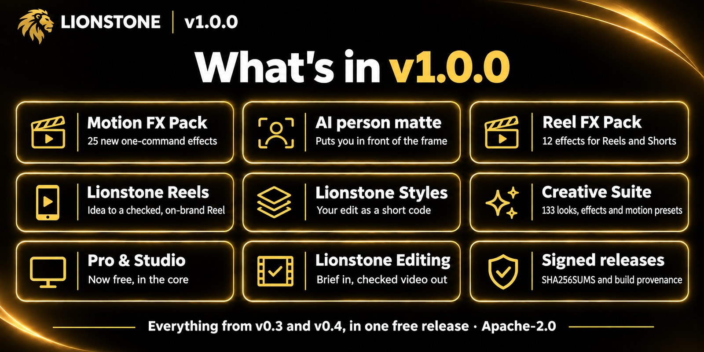
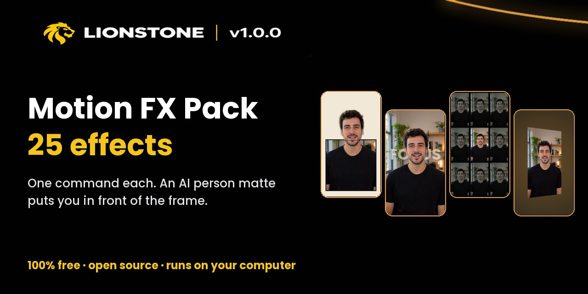
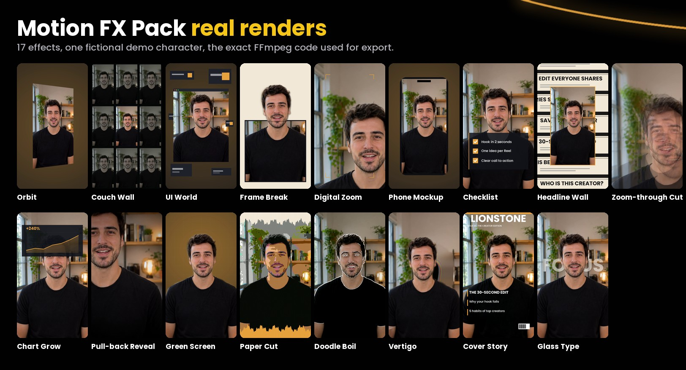
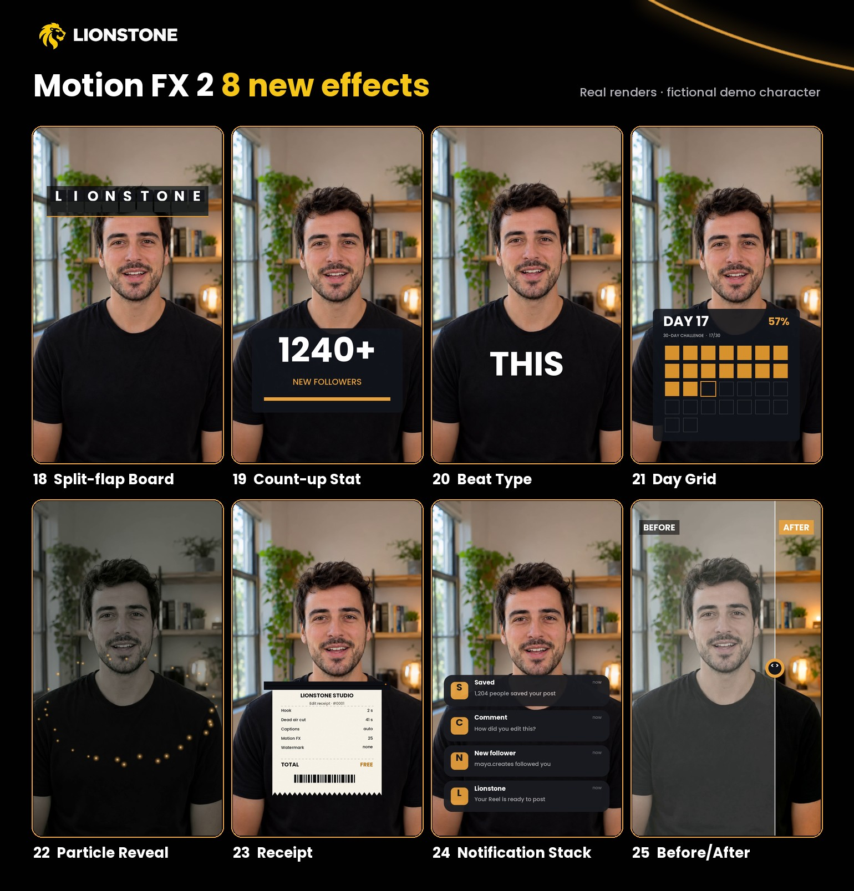
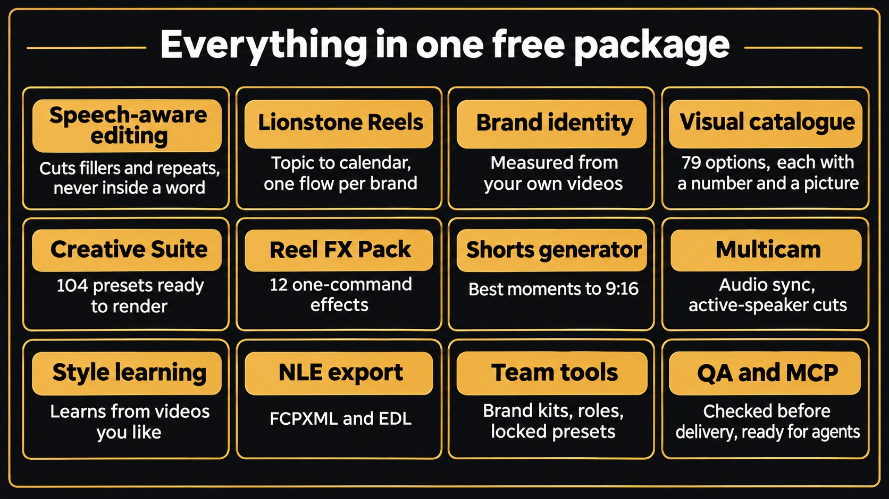
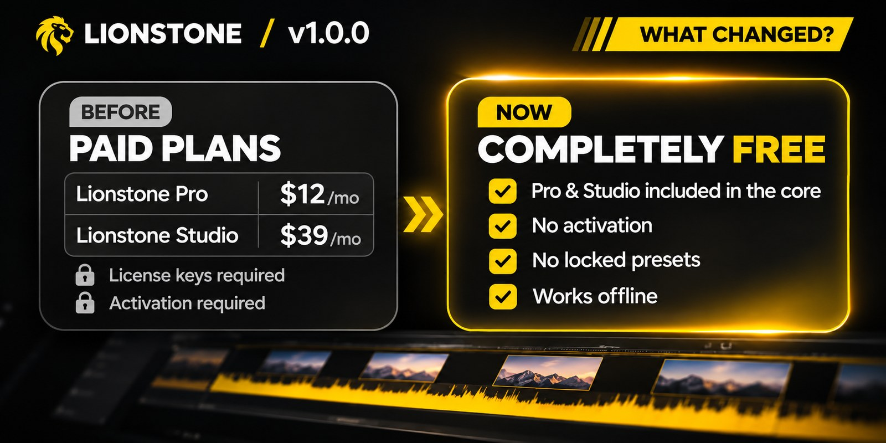
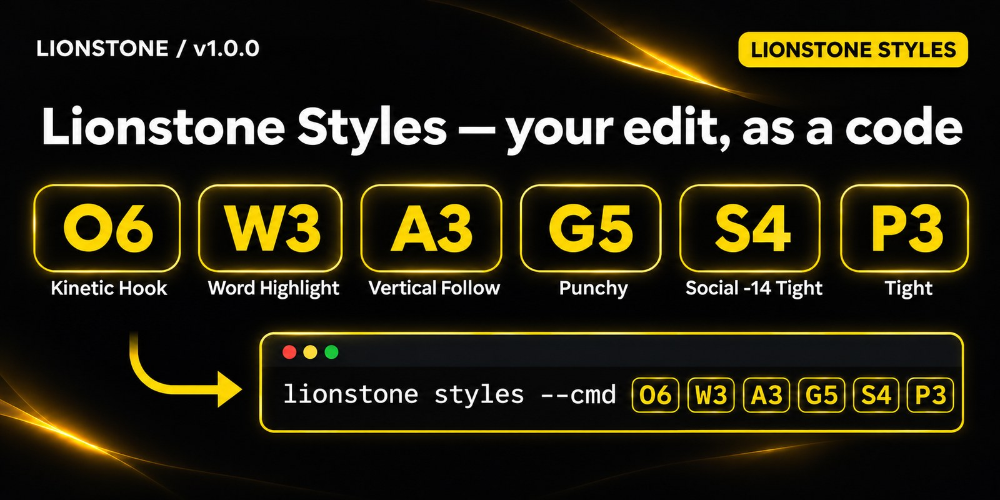
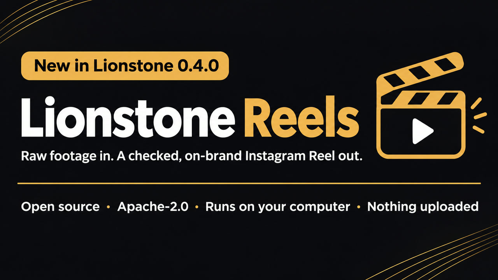

**Lionstone v1.0.0 is the first complete release: the whole AI video editor in one free, open-source package. It adds the Motion FX Pack (25 effects, one command each) and an AI person matte that puts you in front of the frame. Everything from v0.3 and v0.4 is included. No license key, no watermark, no upload. Apache-2.0.**



## New in v1.0.0



- **Motion FX Pack: 25 motion-design effects** for talking-head Reels, Shorts and videos (9:16, 1:1, 16:9): Orbit, Couch Wall, UI World, Frame Break, Digital Zoom, Phone Mockup, Checklist, Headline Wall, Zoom-through Cut, Chart Grow, Pull-back Reveal, Green Screen, Paper Cut, Doodle Boil, Vertigo, Cover Story, Glass Type, and the eight of Motion FX 2: Split-flap Board, Count-up Stat, Beat Type, Day Grid, Particle Reveal, Receipt, Notification Stack and Before/After. The preview, the showcase reel and the final export use the same FFmpeg code. Guide: [docs/motion-fx.md](https://github.com/ismailarslantas/lionstone/blob/v1.0.0/docs/motion-fx.md).
- **AI person matte.** Frame Break, Vertigo, Glass Type, Green Screen and Doodle Boil cut you out of the shot: your head breaks over the frame, big type sits behind you, and any room becomes a brand stage without a green screen. It uses U²-Net small (4.6 MB, Apache-2.0) on the CPU, downloaded once, checked by SHA-256 and cached per file. It is automatic with `lionstone[all]`; without OpenCV the effects fall back to their plain FFmpeg versions.
- **Theatre.js keyframes for Remotion titles**: the `useTheatreSequence()` hook drives a title from a keyframed Theatre.js sequence (`@theatre/core`, Apache-2.0). Guide: [docs/motion-fx-2.md](https://github.com/ismailarslantas/lionstone/blob/v1.0.0/docs/motion-fx-2.md).
- **Synfig backend** (optional): `lionstone fx synfig overlay.sif --input talk.mp4 -o out.mp4` renders a Synfig animation with the external `synfig` program and composites it over your video. Synfig (GPL) runs as a separate program and is never bundled.
- **`lionstone fx clip <effect> in.mp4 -o out.mp4`**: apply one effect to a whole clip at its own size.
- **Lionstone Editing**: Lionstone's own production loop for AI assistants. A short brief and your footage go in; `lionstone editing run` plans the edit, applies the look and the Motion FX / Reel FX from the brief, renders, runs QA on the final file and writes a report. Every stage is recorded, so a run can stop for your review and pick up where it left off. Also available as MCP tools (`editing_init`, `editing_run`, `editing_status`) and a Claude skill. Guide: [docs/editing.md](https://github.com/ismailarslantas/lionstone/blob/v1.0.0/docs/editing.md).
- **Signed, verifiable releases and a hardened repository**: CodeQL code scanning, OpenSSF Scorecard, Dependabot, actions pinned to commit SHAs with read-only tokens, CODEOWNERS, and release files built by GitHub Actions with `SHA256SUMS` and a signed build provenance attestation ([SECURITY.md](https://github.com/ismailarslantas/lionstone/blob/v1.0.0/SECURITY.md)).





*Real Lionstone renders on a fictional example character.*

## Everything else is included, and all of it is free



v1.0.0 replaces every earlier release. Nothing from v0.3 or v0.4 was dropped:

- **Pro & Studio, now in the core.** Lionstone Pro and Studio used to be paid plans. Every feature now ships here: multicam with audio sync and active-speaker cuts, style learning from videos you like, the Shorts generator, FCPXML and EDL export, team presets with history and locks, brand kits, roles and batch apply. There is nothing to buy, activate or renew.
- **Smart editing.** Cuts filler words, stutters, repeated phrases and false starts, never inside a word. Every cut and its reason is in `plan.json`; edit the transcript to change the video; restore any cut with one command.
- **Creative Suite.** 133 original looks, effects, transitions and motion presets plus 25 animated text styles, with before/after previews and karaoke captions.
- **Reel FX Pack.** 12 one-command effects for Reels and Shorts, such as stage-light, insight-split and pixel-resolve ([docs/reel-fx.md](https://github.com/ismailarslantas/lionstone/blob/v1.0.0/docs/reel-fx.md)).
- **Lionstone Reels.** Brand-specific Instagram Reels from idea to delivery: topic, hook, script, shoot, cut, captions, sound, QA, covers and a content calendar, with your brand identity measured from your own videos and a visual catalogue to choose from ([docs/reels.md](https://github.com/ismailarslantas/lionstone/blob/v1.0.0/docs/reels.md)).
- **Lionstone Styles.** Your whole edit as a short code such as `O6 W3 A3 G5 S4 P3`, with ready-made recipes for podcast clips, talking-head Reels, cinematic talks and corporate explainers.
- **Quality checks before delivery.** EBU R128 loudness, black or frozen frames, audio glitches, caption timing and a vision check that text does not cover faces. A check that cannot run is reported as skipped, never as passed.
- **In English.** Command help, delivery reports, the editing room and the full guide are in English; hooks, captions and speech recognition work in English and Turkish. The Reel Handbook is a free PDF.
- **Agents and MCP.** Use Lionstone from Claude and other MCP clients.







## Install

```bash
pip install "lionstone[all] @ git+https://github.com/ismailarslantas/lionstone@v1.0.0"
lionstone doctor
lionstone fx list --category motion-fx
lionstone fx clip glass-type talk.mp4 -o glass-type.mp4 --param text=FOCUS
```

## Verify this release

```bash
sha256sum -c SHA256SUMS --ignore-missing
gh attestation verify lionstone-1.0.0-py3-none-any.whl --repo ismailarslantas/lionstone
```

## Upgrading from 0.x

Projects, brands and plans from 0.3 and 0.4 keep working. `lionstone pro activate/status/renew` no longer exist because nothing needs a key; `lionstone pro whoami` is now `lionstone whoami`. The older releases (0.3.0 to 0.4.2) were retired with v1.0.0. Full list of changes: [CHANGELOG.md](https://github.com/ismailarslantas/lionstone/blob/v1.0.0/CHANGELOG.md).
